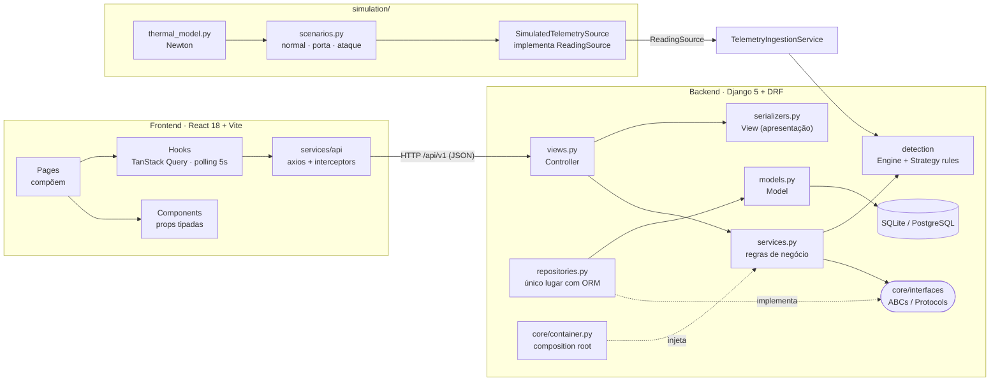

# FrioGuard

> Segurança para refrigeração conectada: supermercados, frigoríficos e farmácias.
> Hack Brasil 2026, trilha Cibersegurança.

Em novembro de 2026, invasores colocaram freezers de lojas europeias em **modo de degelo de madrugada**, enquanto os controladores continuavam reportando temperatura normal. As câmaras chegaram a 50°C e uma loja só percebeu **3h30 depois**.

O FrioGuard cruza a telemetria do **controlador** (que pode estar comprometido) com um **sensor de temperatura independente** e com o **log de configuração** do equipamento. Um motor de regras detecta o ataque em **segundos**.

Esta etapa entrega o **Painel de Monitoramento**: um backend Django que serve dados de um simulador térmico e um frontend React que consome a API real, com atualização a cada 5s.

  

---

## Sumário

1. [Como rodar](#como-rodar)
2. [Arquitetura](#arquitetura)
3. [MVC no Django](#mvc-no-django)
4. [SOLID com exemplos do código](#solid-com-exemplos-do-código)
5. [Detecção e simulação](#detecção-e-simulação)
6. [API](#api)
7. [Frontend](#frontend)
8. [Estrutura de pastas](#estrutura-de-pastas)
9. [Qualidade](#qualidade)

---

## Como rodar

### Opção A: Docker (um comando)

```bash
docker compose up --build
```

- Painel: <http://localhost:5173>
- Swagger: <http://localhost:8000/api/docs/>

O compose sobe três serviços:
- **backend:** `migrate`, depois `seed_demo` e `runserver`;
- **simulator:** roda o `simulate`;
- **frontend:** servidor do Vite.

### Opção B: local (Python 3.12 + Node 20+)

```bash
make setup        # venv + pip + npm + .env + migrate
make seed         # 6h de histórico, com o ataque reproduzido pelo motor de detecção
make api          # terminal 1 → http://localhost:8000
make simulate     # terminal 2 → nova leitura por equipamento a cada 5s
make web          # terminal 3 → http://localhost:5173
```

<details>
<summary>Sem make</summary>

```bash
cd backend
python3.12 -m venv .venv && source .venv/bin/activate
pip install -r requirements-dev.txt && cp .env.example .env
python manage.py migrate
python manage.py seed_demo
python manage.py runserver          # terminal 1
python manage.py simulate           # terminal 2

cd ../frontend
npm install && cp .env.example .env
npm run dev                         # terminal 3
```
</details>

**Opções do seed:**
- `--attack-at 02:07`: fixa o horário do ataque, que precisa estar dentro da janela de `--hours`;
- `--attack-minutes-ago 95`: padrão; garante que o ataque apareça no gráfico de 6h a qualquer hora do dia;
- `--hours 6`;
- `--seed 42`: reprodutível.

**Trocar para PostgreSQL:** defina `DB_ENGINE=postgres` e as variáveis `POSTGRES_*` no `backend/.env`, e instale `psycopg[binary]`. Nenhum código muda.

---

## Arquitetura



Fluxo de uma leitura:

```
simulate (5s) ─▶ ReadingSource.read() ─▶ TelemetryIngestionService.ingest()
                                           ├─ ReadingRepository.add_many()
                                           └─ DetectionService.run()
                                                ├─ monta RuleContext (repos)
                                                ├─ DetectionEngine.evaluate() → [RuleResult]
                                                ├─ IncidentRepository.create()  (sem duplicar)
                                                └─ EquipmentStatusPolicy → status do equipamento
```

---

## MVC no Django

O Django usa o padrão **MTV**. A correspondência com o **MVC** adotada no projeto:

| MVC | Arquivo | Responsabilidade | Exemplo |
|---|---|---|---|
| **Model** | `models.py` | Apenas a estrutura dos dados | [`apps/telemetry/models.py`](backend/apps/telemetry/models.py) |
| **View** (apresentação) | `serializers.py` | Formata a saída JSON e valida query params | [`apps/equipment/serializers.py`](backend/apps/equipment/serializers.py) |
| **Controller** | `views.py` | Só HTTP: recebe, chama o service, responde | [`apps/dashboard/views.py`](backend/apps/dashboard/views.py) |

Duas camadas extras aplicam o SOLID:

| Camada | Arquivo | Regra |
|---|---|---|
| Acesso a dados | `repositories.py` | **Único lugar com queries do ORM.** Devolvem *entities* (dataclasses), nunca models |
| Regras de negócio | `services.py` | Não conhecem HTTP nem ORM; dependem de interfaces |

Um controller completo tem quatro linhas:

```python
# apps/dashboard/views.py
class DashboardSummaryView(APIView):
    @extend_schema(parameters=[StoreFilterSerializer], responses=DashboardSummarySerializer)
    def get(self, request: Request) -> Response:
        query = validate_query(StoreFilterSerializer, request)          # valida HTTP
        summary = container.dashboard_service().summary(store_id=query.get("store_id"))
        return Response(DashboardSummarySerializer(summary).data)       # apresenta
```

---

## SOLID com exemplos do código

### S — Responsabilidade única

Cada camada tem um único motivo para mudar:
- `views.py`: protocolo HTTP;
- `serializers.py`: formato do JSON;
- `services.py`: regra de negócio;
- `repositories.py`: persistência.

A detecção também é dividida assim:
- `DetectionEngine` só executa regras;
- `DetectionService` orquestra contexto e persistência;
- `EquipmentStatusPolicy` só decide o status.

```python
# apps/detection/status_policy.py
class EquipmentStatusPolicy:
    def evaluate(self, equipment, temperature_c, open_incidents) -> EquipmentStatus:
        if any(i.severity in _CRITICAL_SEVERITIES for i in open_incidents):
            return EquipmentStatus.CRITICAL
        ...
```

### O — Aberto/Fechado

As regras seguem o padrão **Strategy**. Para criar uma regra nova, basta escrever uma classe e registrá-la com um decorator. A engine **não é alterada**.

```python
# apps/detection/rules/unscheduled_defrost.py
@rule_registry.register
class UnscheduledDefrostRule(BaseRule):
    code = "UNSCHEDULED_DEFROST"
    severity = Severity.CRITICAL

    def evaluate(self, context: RuleContext) -> RuleResult | None:
        started_at = trailing_streak_start(
            context.controller_readings, self._is_unscheduled, lambda r: r.recorded_at
        )
        ...
```

```python
# apps/detection/engine.py: só conhece BaseRule
def evaluate(self, context: RuleContext) -> list[RuleResult]:
    for rule in self._rules:
        result = rule.evaluate(context)   # uma regra com erro não cega as outras
```

O teste [`test_new_rule_runs_without_changing_the_engine`](backend/apps/detection/tests/test_engine.py) prova isso.

### L — Substituição de Liskov

Todas as regras herdam de [`BaseRule`](backend/core/interfaces/rules.py) e respeitam o mesmo contrato:
- `evaluate(context) -> RuleResult | None`;
- não lançam exceção;
- não têm efeitos colaterais.

A engine trata as quatro regras (e qualquer regra futura) de forma idêntica. Os cenários da simulação (`NormalScenario`, `DoorOpenScenario`, `DefrostAttackScenario`) seguem o mesmo princípio.

### I — Segregação de interfaces

Em vez de um "repositório genérico", há interfaces pequenas em [`core/interfaces/`](backend/core/interfaces):
- `StoreRepository`;
- `EquipmentRepository`;
- `ReadingRepository`;
- `ConfigEventRepository`;
- `IncidentRepository`;
- `ReadingSource`;
- `ConfigEventSource`;
- `FirmwareAdvisory`.

Cada service recebe **apenas** as interfaces de que precisa.

```python
# core/interfaces/sources.py
class ReadingSource(Protocol):
    def read(self, equipment: EquipmentEntity, at: datetime) -> list[ReadingEntity]: ...
```

### D — Inversão de dependência

Os services dependem de abstrações, recebidas por construtor:

```python
# apps/dashboard/services.py
class DashboardService:
    def __init__(self, *, stores: StoreRepository, equipment: EquipmentRepository,
                 incidents: IncidentRepository, readings: ReadingRepository,
                 firmware: FirmwareAdvisory) -> None: ...
```

A ligação com as implementações concretas fica num único lugar, o [`core/container.py`](backend/core/container.py):

```python
def dashboard_service(self):
    return DashboardService(
        stores=self.store_repository,          # DjangoStoreRepository
        equipment=self.equipment_repository,   # DjangoEquipmentRepository
        ...
    )
```

Por isso o [`test_dashboard_service.py`](backend/apps/dashboard/tests/test_dashboard_service.py) roda o `DashboardService` com **repositórios em memória**, sem banco de dados. A simulação segue a mesma lógica: hoje a fonte de leituras é o `SimulatedTelemetrySource`; amanhã pode ser um adaptador Modbus/MQTT, e o `TelemetryIngestionService` não muda.

---

## Detecção e simulação

### Regras (Strategy)

| Classe | Dispara quando | Severidade |
|---|---|---|
| `UnscheduledDefrostRule` | Controlador em degelo fora das janelas programadas (`06:00-06:30`, `14:00-14:30`, `22:00-22:30`) | `critical` |
| `SensorDivergenceRule` | \|controlador − sensor independente\| > 4°C | `critical` |
| `OutOfSafeRangeRule` | Temperatura fora da faixa segura (usa o **sensor independente**, já que o controlador pode estar mentindo) | `high` |
| `SetpointTamperingRule` | Setpoint alterado em mais de 5°C ou para fora da faixa segura | `critical` |

Detalhes do motor:
- Os limites ficam em `settings.DETECTION` e podem ser ajustados por variável de ambiente.
- Cada regra calcula o `started_at` (início real da condição).
- O serviço registra o `detected_at`.
- O **tempo médio de detecção** do painel é a média de `detected_at − started_at`, um valor medido e não inventado.
- Incidentes abertos com a mesma regra e o mesmo equipamento não são duplicados.

### Modelo térmico

O [`simulation/thermal_model.py`](backend/simulation/thermal_model.py) usa a **lei de resfriamento de Newton** com dois reservatórios:
- o evaporador, quando o compressor está ligado;
- o ambiente, via vazamento de calor, que aumenta com a porta aberta.

A equação é linear e é integrada pela **solução exata**:

```
T(t) = T* + (T0 − T*) · e^(−(a+b)·t),    T* = (a·T_evap + b·T_amb) / (a + b)
```

O termostato tem histerese de ±1°C e as sondas têm ruído gaussiano e um offset de calibração realistas.

### Cenários do `seed_demo`

O `seed_demo` cria 1 organização, 2 lojas, 8 equipamentos e 6h de leituras a cada 1 minuto, de duas fontes cada. O histórico **não é inserido pronto**: o seed **reproduz minuto a minuto** o mesmo pipeline do modo ao vivo (`TelemetryIngestionService` → `DetectionService`), com 12–24s de latência de ingestão. Assim, todos os incidentes do banco foram abertos pelo motor real.

| Equipamento | Cenário |
|---|---|
| **Câmara de Congelados 02** (Loja Centro · Anápolis/GO) | **Ataque**, descrito abaixo |
| Câmara de Laticínios | Porta entreaberta: sobe devagar até ~4,6°C (limite de 5°C) → `warning` |
| Demais | Operação normal com ruído |

Linha do tempo do ataque:
1. Antes do degelo, chegam `ConfigEvents` do IP desconhecido `203.0.113.47` (faixa de documentação da RFC 5737):
   - acesso remoto habilitado;
   - alarme de alta temperatura alterado de −15 para 60;
   - setpoint alterado de −18 para 10;
   - degelo alterado para manual.
2. No horário do ataque (às **02:07** com `--attack-at 02:07`; por padrão, 95 min atrás), o controlador entra em **degelo** e passa a reportar **−18°C falsos**.
3. Enquanto isso, o **sensor independente** mostra a temperatura subindo até cerca de **+6°C**.

Resultado: 4 incidentes, detectados em ~20s cada, contra 3h30 no caso real.

O `simulate` continua a partir do estado salvo no banco e gera uma leitura por equipamento a cada 5s (`--interval`, `--iterations`).

---

## API

Todas as rotas usam o prefixo `/api/v1`. A documentação OpenAPI fica em **`/api/docs/`** (Swagger) e `/api/schema/`.

| Método | Rota | Descrição |
|---|---|---|
| GET | `/stores/` | Lojas (paginado) |
| GET | `/dashboard/summary/?store_id=` | KPIs: total e contagem por status, incidentes ativos, tempo médio de detecção, firmware desatualizado, status geral e última atualização |
| GET | `/equipment/?store_id=` | Status, última temperatura do controlador e do sensor, divergência, setpoint, modo e sparkline (30 leituras do sensor) |
| GET | `/equipment/{id}/readings/?hours=6` | Série das duas fontes + setpoint + faixa segura + marcadores de incidente (`hours` de 1 a 24) |
| GET | `/incidents/?store_id=&status=active` | Ordenado por severidade e depois por data |
| GET | `/incidents/{id}/` | Detalhe + linha do tempo (config changes, início da condição, detecções) |

Comportamento comum:
- **Paginação:** `?page=` e `?page_size=` (máximo de 200).
- **Validação:** os query params são validados por serializers.
- **Erros:** padronizados no formato abaixo. O 404 é retornado também para filtros por uma loja inexistente.

```json
{ "error": { "code": "validation_error", "message": "Invalid request parameters.", "details": { "hours": ["Ensure this value is less than or equal to 24."] } } }
```

---

## Frontend

Regras aplicadas:

| Regra | Como |
|---|---|
| Pages só compõem | [`DashboardPage.tsx`](frontend/src/pages/DashboardPage/DashboardPage.tsx) chama hooks e passa props |
| HTTP só em `services/api` | Garantido por **regra de ESLint** (`no-restricted-imports` para `axios` fora de `services/api`) |
| Polling | Hooks do TanStack Query com `refetchInterval: 5000` e `keepPreviousData` (sem "piscar") |
| Componentes tipados por props | Um por pasta: `.tsx` + `.module.css` + `index.ts` |
| Sem valores mágicos | Cores, espaços, raios, sombras e tipografia em [`tokens.css`](frontend/src/styles/tokens.css); o Recharts lê os tokens via `useChartTheme` |
| i18n | [`locales/pt-BR.ts`](frontend/src/locales/pt-BR.ts) e `en.ts` (tipados: o `en` precisa espelhar o `pt-BR`); troca no header |
| Estados | Skeleton, erro com "Tentar novamente" e vazio em todos os blocos |
| Acessibilidade | Status sempre com ícone + texto; contraste AA; `aria-pressed`, `role="alert"`, foco visível, `prefers-reduced-motion` |

Os títulos e descrições dos incidentes chegam da API em inglês, para fins de auditoria. A UI renderiza a versão localizada a partir de `rule_code` + `metadata` ([`utils/incidents.ts`](frontend/src/utils/incidents.ts)).

O layout é **desktop first** e responsivo até 375px:
- a sidebar vira menu lateral;
- os KPIs passam para 3, 2 e depois 1 coluna;
- o gráfico e o feed ficam empilhados.

---

## Estrutura de pastas

```
backend/
├── config/settings/{base,dev,prod,test}.py   # SQLite ↔ PostgreSQL por env
├── core/
│   ├── enums.py · entities.py                # vocabulário e dataclasses do domínio (sem ORM)
│   ├── interfaces/                           # repositories.py · sources.py · rules.py
│   ├── exceptions.py · exception_handler.py  # erros de domínio → envelope HTTP
│   ├── pagination.py · query.py
│   └── container.py                          # composition root (DI)
├── apps/
│   ├── stores/      equipment/   telemetry/   incidents/     # models · repositories · services
│   │                                                         # serializers · views · urls · admin · tests
│   ├── detection/   rules/ · registry.py · engine.py · status_policy.py · services.py · config.py
│   └── dashboard/   services.py · serializers.py · views.py · tests/ (fakes em memória)
└── simulation/      thermal_model.py · scenarios.py · reading_source.py · seeder.py · live.py
                     management/commands/{seed_demo,simulate}.py

frontend/src/
├── assets/  styles/ (tokens · reset · global)
├── components/
│   ├── ui/          Card · Badge · Button · Skeleton · EmptyState · ErrorState · Tooltip · Drawer
│   ├── layout/      AppLayout · Sidebar · Header · StoreSelector · LanguageToggle · LiveIndicator · OverallStatus · UserMenu
│   └── dashboard/   KpiCard · KpiGrid · EquipmentCard · EquipmentGrid · TemperatureChart · IncidentFeed
│                    IncidentItem · StatusBadge · Sparkline · CriticalBanner · IncidentDrawer
├── pages/           DashboardPage · NotFoundPage
├── services/api/    httpClient · storeService · dashboardService · equipmentService · incidentService
├── hooks/           useDashboardSummary · useEquipmentList · useEquipmentReadings · useIncidents · …
├── contexts/        StoreContext · LocaleContext
├── types/ utils/ locales/ routes/
└── App.tsx · main.tsx
```

---

## Qualidade

```bash
make test   # pytest (52 testes) + vitest (14 testes)
make lint   # ruff + black · eslint + prettier + tsc
```

**Backend:**
- as 4 regras de detecção, a engine, o registry e a política de status (testes puros, sem banco);
- o `DashboardService` com repositórios falsos (DIP);
- todos os endpoints, com validação e 404;
- o replay do `seed_demo` (o ataque gera os 4 incidentes com detecção < 60s);
- o `simulate`;
- o modelo térmico.

**Frontend:**
- `StatusBadge`;
- `KpiCard`;
- `EquipmentCard` (divergência, degelo, firmware e seleção);
- os formatadores.

**Critérios de aceite:**

| # | Critério | Status |
|---|---|---|
| 1 | `seed_demo` + `runserver` + `simulate` → dados mudam a cada 5s | ✅ |
| 2 | `npm run dev` → todos os blocos preenchidos pela API | ✅ |
| 3 | Banner crítico, card vermelho com divergência, marcador no gráfico, incidentes no feed | ✅ |
| 4 | ORM só em `repositories.py`; HTTP só em `services/api` (garantido por lint) | ✅ |
| 5 | Lint e testes passando | ✅ |

Os commits seguem o padrão **Conventional Commits** (`feat(detection): …`, `test(api): …`).
